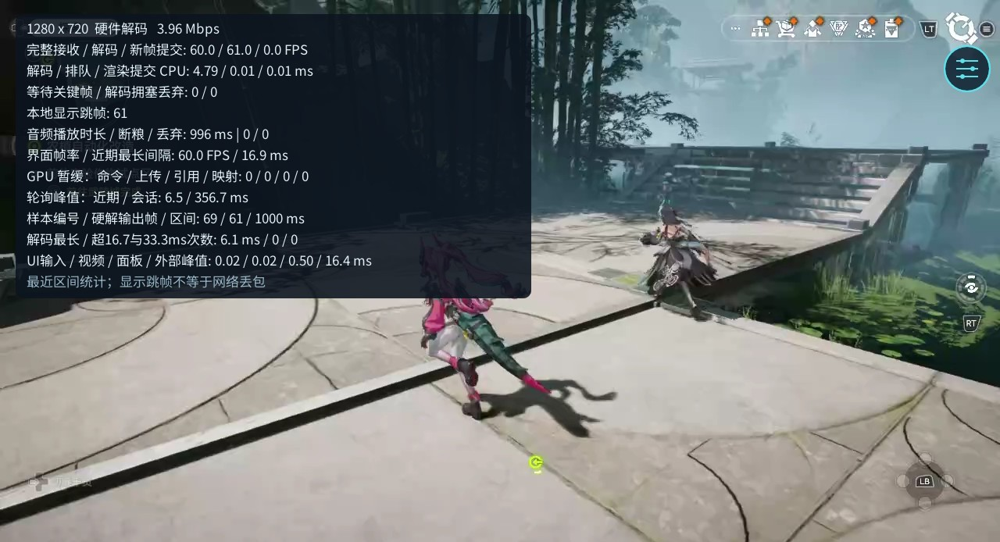

# 圆石启动器 · ZMD 独立版

面向 Nintendo Switch 的非官方 ZMD 云游戏客户端。可在 Switch 原生系统下通过 hbmenu 使用。

[下载 0.2.152 alpha](https://github.com/Steve1451-dot/yuanshi-zmd-ns/releases/tag/v0.2.152)

## 安装与使用

1. 打开发布页，下载 `yuanshi-endfield-classic-0.2.152.zip`，将压缩包里的 `switch` 文件夹合并到 SD 卡根目录。也可单独下载 NRO 放入 `switch/`。
2. 在完整应用模式下运行 hbmenu，打开对应的 ZMD 独立版。有效登录会自动启动或排队，需要重新登录时按提示扫码。
3. 更新时保留 `switch/yuanshi-launcher/` 下的设置和登录数据，替换该版本的 NRO 即可。

基于 0.2.113 当时的源码重建，保留旧串流链路和硬解异常退出保护。首次启动请求 60 FPS 和中画质（8 Mbps 上限）。

本预发行已通过 Switch 构建和离线回归检查，当前包的线上入场仍待实机验证。仅供学习交流，与游戏厂商和任天堂无隶属或背书关系。

## 源码构建

在装有 devkitPro 和 Switch 依赖的环境中运行 `bash scripts/build-switch-msys2.sh`。Windows 可运行 `./build-switch.ps1`。默认构建 ZMD 独立版，输出位于 `build/switch/yuanshi-launcher.nro`。

## 许可

本仓库保留上游的 [MIT License](LICENSE) 与版权声明，第三方组件继续遵循各自许可证。
重命名不抹去上游来源，也不将第三方内容重新许可。

## 致谢与参考（References）

本项目由 [Steve1451-dot](https://github.com/Steve1451-dot) 维护。
感谢以下基础项目、参考资料与开源组件的作者；本仓库的提交历史整理不改变上游代码的版权与许可。

- [OpenNOW-Switch / OpenCloudGaming](https://github.com/OpenCloudGaming/OpenNOW-Switch)：
  本项目的直接基础，沿用并改进其 Switch 原生串流、渲染、输入与应用框架。
- [SwitchNOW / Blade-Punisher](https://github.com/Blade-Punisher/SwitchNOW)：
  OpenNOW-Switch 的上游项目，提供早期 Switch 云游戏客户端实现。
- [OpenNOW 文档](https://opennow.zortos.me)：上游项目的使用与技术参考。

核心依赖包括
[Borealis](https://github.com/xfangfang/borealis),
[libpeer](https://github.com/sepfy/libpeer),
[FFmpeg](https://github.com/FFmpeg/FFmpeg),
[libnx](https://github.com/switchbrew/libnx),
[deko3d](https://github.com/devkitPro/deko3d),
[curl](https://github.com/curl/curl),
[Jansson](https://github.com/akheron/jansson) 和
[zlib](https://github.com/madler/zlib).

对应许可证与署名文件保留在各依赖目录中；分发时也应保留适用的许可证和声明。
